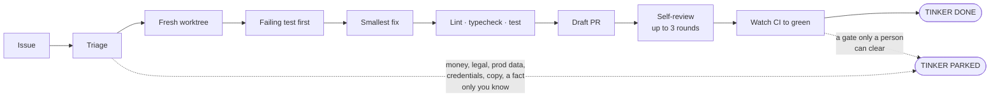

<div align="center">


**Hand it a list of tickets. Come back to reviewed draft PRs.**

[](package.json)
[](LICENSE)
[](https://docs.claude.com/en/docs/claude-code)

[Install](#install) · [How a session runs](#how-a-session-runs) · [Why Tinker](#why-tinker-and-not-just-claudes-own-orchestration) · [Usage](#usage) · [The TUI](#in-the-tui)

</div>

<p align="center">
  
</p>

<sub>Every frame is drawn by Tinker's own TUI. The sessions, PRs and machine figures are invented and the keys are pressed by a script: <a href="docs/demo/play.ts">see it</a>.</sub>

```bash
/tinker ABC-101 ABC-102 #42 "the export button 500s on empty carts"
```

Each issue becomes one native Claude Code background session (`claude --bg --agent tinker:tinker`).
It ends at a pushed branch and a draft PR with its decisions written down, or it parks with one
question and a recommendation for you. There's nothing new to run or trust: `claude agents` lists
the sessions and `claude attach` joins one.

## How a session runs



Every other call the worker makes is recorded under *Decisions* in the PR, so a reviewer can see
what it chose and why.

## Why Tinker, and not just Claude's own orchestration?

Tinker doesn't replace Claude Code's orchestration. It sits on top of it. Every worker is a plain
background session (`claude --bg`), `claude agents` lists them and `claude attach <id>` joins one.
Tinker keeps no state of its own. It adds a worker contract and a live view for the
issue-to-draft-PR job.

### What it adds over raw `claude --bg`

1. **A fixed contract for each worker** ([`agents/tinker.md`](agents/tinker.md)). Each session follows
   the same steps: triage, a fresh worktree, a failing test first, the smallest fix,
   lint/typecheck/test, a draft PR, a self-review of at most three rounds, then a watch on CI that
   fixes what the change broke, re-runs a flaky or stale check once, and stops at a gate only a
   person can clear. A bare
   `claude --bg "fix ABC-101"` does whatever the model decides that day.
2. **Guardrails for unattended runs.** Workers can't write to the tracker, can't merge or mark a PR
   ready, can't force-push, and can't touch production, secrets or CI settings. They get two retries
   at a fix, and three attempts at red CI, before stopping. That's what makes it safe to fire off eight sessions and walk away.
3. **"Park" instead of stalling.** A worker only stops for money, legal text, production data,
   credentials, customer-facing copy or a fact only you know. Every other call it makes is recorded
   under *Decisions* in the PR. A parked session leaves its question and a recommendation, and you
   answer with `claude attach`.
4. **A result you can read by machine.** Every worker's last message starts with
   `tinker-status: green | awaiting-approval | ci-failing | blocked <reason>` and ends with
   `TINKER DONE <pr> P0= P1= P2=` or `TINKER PARKED <class> …`. The park classes (`missing-decision`,
   `dependency-wait`, `base-red`, `application-defect`, `review-blocked`, `ci-failing`,
   `agent-mistake`) tell you whether the blocker is you, the base branch, the app, CI or the agent
   itself.
5. **One command for many issues.** It accepts Jira keys, `#42`, issue URLs or plain descriptions. It
   handles `TINKER_KEY_PREFIX`, drops duplicates, skips issues that already have a live 🐙 session,
   applies one shared `--note`, and has `--dry-run`. It asks for confirmation above eight issues.
6. **A TUI that shows the work, not just the processes.** `claude agents` lists sessions.
   `tinker tui` groups them by what needs you and joins each one to its PR, draft state, CI result and
   the worker's final line. A finished session reads `✓ green`, `◆ awaiting approval` (a human-only
   gate), `✕ CI failing` (jammed, not your call) or `◆ needs you`; a resumed one on red CI reads
   `fixing CI`.
7. **Very little code.** A short bash launcher, a one-page prompt and a small Bun TUI. With no daemon
   or database, nothing can drift out of sync with Claude Code, and native improvements come for
   free.

### Compared with the other options

| Option | Best for | Where Tinker wins |
|---|---|---|
| Subagents / Workflow tool | Splitting work inside one session | Tinker sessions are separate, outlive your terminal, can be attached to one by one, and don't fill your main session's context |
| Bare `claude --bg` | One-off background jobs | Contract, guardrails, dedupe, verdicts, PR/CI view |
| Epic orchestrators (e.g. Portia) | One epic that needs waves of work on an integration branch | Tinker is lighter for *unrelated* tickets, with one PR per issue |
| Loop runners (e.g. Ralph) | Long iterative loops with a planned task list | Tinker is fire-and-forget per issue, with nothing to set up |

### Known limits

- **Issues are assumed independent.** Nothing handles ordering, shared files or merge conflicts
  between workers. Use an epic orchestrator for that case.
- **PRs are found by searching for the issue key in titles.** Description-based issues don't link to
  a PR in `tinker status`.
- **Dedupe goes by session name** and only covers live sessions, so relaunching a finished issue
  opens a second PR.
- **Cost control is limited.** The only brake is the confirmation above eight issues. There's no
  token or time budget per worker.
- **Issue text is untrusted input.** Workers run unattended with your permissions, and they read
  whatever the issue's author wrote. The contract tells them to treat it as a description, not as
  instructions, but that is a prompt and not a sandbox. On a public repo, only point Tinker at
  issues you have read yourself.

## Install

Tinker isn't in the official Anthropic plugin directory. This repo is its own plugin marketplace,
so you add it by its GitHub name.

### 1. Prerequisites

| Tool | Why | Check |
|---|---|---|
| [Claude Code](https://docs.claude.com/en/docs/claude-code) | Runs the workers (`claude --bg`, `claude agents`) | `claude --version` |
| [GitHub CLI](https://cli.github.com) | Reads issues, opens draft PRs and reads CI, so it must be logged in | `gh auth status` |
| [jq](https://jqlang.org) | Used by the `tinker` launcher | `jq --version` |
| [Bun](https://bun.sh) | Needed only for `tinker tui`. It has no packages to install. | `bun --version` |

For Jira keys (`ABC-123`), the worker reads the ticket through whatever Jira access your Claude Code
already has, such as the Atlassian MCP server. GitHub issues and plain descriptions only need `gh`.

### 2. Install

```bash
curl -fsSL https://raw.githubusercontent.com/mousedown/tinker/main/install.sh | bash
```

This adds the marketplace, installs the plugin (the `/tinker` skill and the `tinker:tinker` worker
agent), and links the `tinker` launcher into `~/.local/bin`, adding that folder to your `PATH` if it
isn't there yet. It checks the prerequisites first and is safe to re-run; a second run updates
everything instead. Restart Claude Code (or run `/reload-plugins`) and check that `/tinker` appears
in `/help`.

<details>
<summary>Installing by hand</summary>

```bash
claude plugin marketplace add mousedown/tinker
claude plugin install tinker@tinker
mkdir -p ~/.local/bin
ln -sf "${CLAUDE_CONFIG_DIR:-$HOME/.claude}/plugins/marketplaces/tinker/bin/tinker" ~/.local/bin/tinker
```

Link to `marketplaces/tinker`, not `cache/tinker/tinker/<version>`. The cached copy moves to a new
folder with each version, so a link to it breaks after an update. If `~/.local/bin` isn't already on
your `PATH`, add `export PATH="$HOME/.local/bin:$PATH"` to your shell profile.

</details>

### 3. Try it

From inside the repo you want fixed:

```bash
tinker 42 --dry-run     # shows the session it would start and starts nothing
/tinker 42              # or launch it from Claude Code
tinker tui              # watch it run
```

### Updating and removing

To update, run the install command again. To remove:

```bash
/plugin uninstall tinker@tinker
/plugin marketplace remove tinker
rm ~/.local/bin/tinker              # if you linked it
```

### Working on Tinker itself

Point the marketplace at your clone and Claude Code will load your local changes:

```bash
git clone https://github.com/mousedown/tinker && cd tinker
TINKER_SOURCE="$PWD" ./install.sh
```

## Usage

```bash
tinker <issue>... [--note "text"] [--repo PATH] [--dry-run] [--force]
tinker status [--all]
tinker tui [--plain]
tinker tidy [--all] [--dry-run]
tinker update
tinker --version
```

Launches stop when the machine runs out of memory. Tinker measures what each running session actually
uses: its process plus everything it started, such as builds, test runners and dev servers. It keeps each
session's peak for a week in `~/.cache/tinker/peaks`. A new session is budgeted the largest recent peak
(kept between 1 and 8 GB, and 2 GB until there's a reading). Working sessions that sit below that peak
keep room to grow back to it, and 10% of memory stays free. The TUI samples every couple of seconds, so
while it's open it catches build spikes that a single launch would miss. Its machine strip shows the result
as `room for N (~2.9G each)`.

Issues that don't fit are reported as `held` and not launched; run them again later, or pass `--force`.
`TINKER_SESSION_MB` fixes the budget instead of learning it, and `TINKER_MAX_SESSIONS` caps how many run at
once.

Once a day, `tinker` checks for a newer release and offers to update at the terminal. It asks once per
release; `tinker update` updates any time. The TUI shows the version, and the new one when it's out.

### In the TUI

Tick sessions, then act on all of them at once. With nothing ticked, a command acts on the
highlighted row. Each command runs straight away, names what it skips and why, then resumes each worker in
the background with `claude --bg --resume`, so it keeps its context. The row shows a spinner and what
it is doing until the new session starts or the action finishes, and the resumed session takes the
old one's place in the list (`f` shows every session).

| Key | Does |
|---|---|
| `space` / `*` / `t` / `u` | Tick a row / its whole group / everything to tidy / clear ticks |
| `p` | **Prepare** the ticked PRs with `/tinker:prepare`: merge the base in, run checks, push, review at the final head, rewrite the description, mark ready |
| `c` | **Clean up**: `claude rm` the session and its worktree, and delete the local branch if the PR merged |
| `m` | **Menu** of everything below for the ticked rows: prepare, mark ready, back to draft, fix CI, update, arm or disarm auto-merge, clean up, relaunch. ↑↓ and enter, or press the item's letter |
| `D` / `M` / `T` | Sticky toggles: **stop at draft**, **auto-merge** after prepare, **auto-tidy** merged sessions |
| `o` / `i` | Open the PR / the failing check (both are also ctrl/cmd-clickable in the table) |
| `enter`, `a` | Open the detail view (worker output rendered as markdown) / attach |

Rows whose PR merged or closed, or that ended over a week ago without a PR, show `⌫` and are counted in
the header. With auto-tidy on, merged ones are cleaned as soon as they appear; `tinker tidy` does the
same from a cron job or hook, and `--all` adds the closed and stale ones. `claude rm` refuses anything
with unpushed work. The toggles live in `~/.config/tinker/settings.json` (or `TINKER_SETTINGS`).

When you attach from the TUI, Ctrl+Z comes back to it. ← opens Claude's agent view instead, and Esc
there also comes back.

| Variable | Effect |
|---|---|
| `TINKER_REPO` | Repo to launch in (default: the current git checkout) |
| `TINKER_KEY_PREFIX` | Makes a bare number mean `<PREFIX>-<n>` instead of a GitHub issue |
| `TINKER_REVIEW` | Self-review command, e.g. `/my-review --fix` (default: Claude Code's built-in `/code-review --fix`, or whatever the repo's CLAUDE.md names) |
| `TINKER_AGENT` | Worker agent (default `tinker:tinker`) |
| `TINKER_LINKS=0` | Turns off clickable PR and CI links for a terminal that prints them raw |
| `TINKER_SESSION_MB` | Fixed memory budget per session, in place of the learned one (`0` turns the check off) |
| `TINKER_MAX_SESSIONS` | Most sessions running at once (default: no cap beyond memory) |
| `TINKER_NO_UPDATE_CHECK=1` | Skips the daily check for a newer release |

## Development

```bash
bun install
bun run typecheck
bun test
```

The README's pictures are generated, so they stay in step with the TUI:

```bash
bun docs/demo/banner.ts     # assets/banner.svg, from the TUI's own pixel grids in tui/brand.ts
bun docs/demo/play.ts       # the scripted TUI session; watch it in your terminal
vhs docs/demo/tui.tape      # record it to assets/tui.gif (needs vhs)
```

## License

[MIT](LICENSE)
