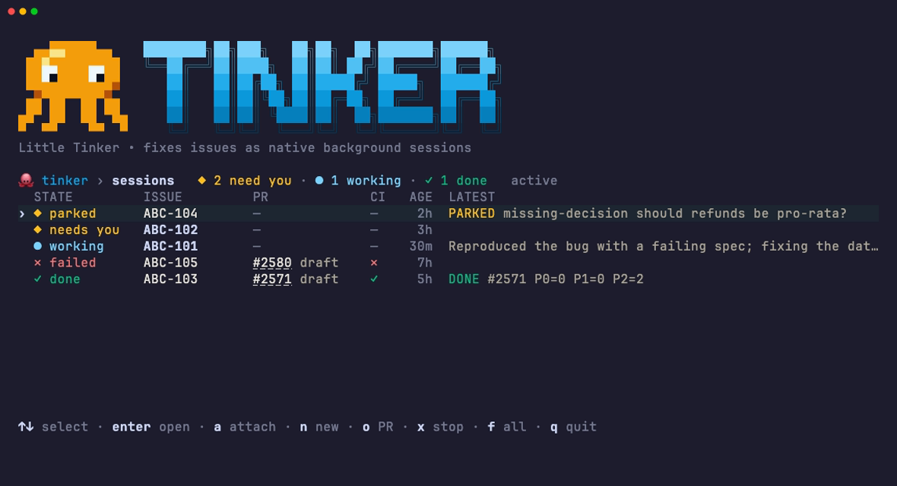

<p align="center"></p>

# Little Tinker

Point it at a list of tickets and come back to draft PRs that have already been reviewed, each with
its decisions written down. It's all native Claude Code sessions, so there's nothing new to run or
trust.

```bash
/tinker ABC-101 ABC-102 #42 "the export button 500s on empty carts"
```

Each issue becomes one `claude --bg --agent tinker:tinker` session that ends at a pushed branch and a
draft PR, or parks with a question for you.



<sub>`tinker tui`, shown with mock data.</sub>

## Why Tinker, and not just Claude's own orchestration?

Tinker doesn't replace Claude Code's orchestration. It sits on top of it. Every worker is a plain
background session (`claude --bg`), `claude agents` lists them and `claude attach <id>` joins one.
Tinker keeps no state of its own. It adds a worker contract and a live view for the
issue-to-draft-PR job.

### What it adds over raw `claude --bg`

1. **A fixed contract for each worker** ([`agents/tinker.md`](agents/tinker.md)). Each session follows
   the same steps: triage, a fresh worktree, a failing test first, the smallest fix,
   lint/typecheck/test, a draft PR, then a self-review of at most three rounds. A bare
   `claude --bg "fix ABC-101"` does whatever the model decides that day.
2. **Guardrails for unattended runs.** Workers can't write to the tracker, can't merge or mark a PR
   ready, can't force-push, and can't touch production, secrets or CI. They get two retries at most
   before stopping. That's what makes it safe to fire off eight sessions and walk away.
3. **"Park" instead of stalling.** A worker only stops for money, legal text, production data,
   credentials, customer-facing copy or a fact only you know. Every other call it makes is recorded
   under *Decisions* in the PR. A parked session leaves its question and a recommendation, and you
   answer with `claude attach`.
4. **A result you can read by machine.** Every worker ends with `TINKER DONE <pr> P0= P1= P2=` or
   `TINKER PARKED <class> …`. The six park classes (`missing-decision`, `dependency-wait`, `base-red`,
   `application-defect`, `review-blocked`, `agent-mistake`) tell you whether the blocker is you, the
   base branch, the app or the agent itself.
5. **One command for many issues.** It accepts Jira keys, `#42`, issue URLs or plain descriptions. It
   handles `TINKER_KEY_PREFIX`, drops duplicates, skips issues that already have a live 🐙 session,
   applies one shared `--note`, and has `--dry-run`. It asks for confirmation above eight issues.
6. **A TUI that shows the work, not just the processes.** `claude agents` lists sessions.
   `tinker tui` groups them by what needs you and joins each one to its PR, draft state, CI result and
   the worker's final line.
7. **Very little code.** A short bash launcher, a one-page prompt and a small Bun TUI. With no daemon
   or database, nothing can drift out of sync with Claude Code, and native improvements come for
   free.

### Compared with the other options

| Option | Best for | Where Tinker wins |
|---|---|---|
| Subagents / Workflow tool | Splitting work inside one session | Tinker sessions are separate, outlive your terminal, can be attached to one by one, and don't fill your main session's context |
| Bare `claude --bg` | One-off background jobs | Contract, guardrails, dedupe, verdicts, PR/CI view |
| Epic orchestrators (e.g. Portia) | One epic that needs waves of work on an integration branch | Tinker is lighter for *unrelated* tickets, with one PR per issue |
| Loop runners (e.g. Ralph) | Long iterative loops with a planned task list | Tinker is fire-and-forget per issue, with nothing to set up |

### Known limits

- **Issues are assumed independent.** Nothing handles ordering, shared files or merge conflicts
  between workers. Use an epic orchestrator for that case.
- **PRs are found by searching for the issue key in titles.** Description-based issues don't link to
  a PR in `tinker status`.
- **Dedupe goes by session name** and only covers live sessions, so relaunching a finished issue
  opens a second PR.
- **Cost control is limited.** The only brake is the confirmation above eight issues. There's no
  token or time budget per worker.
- **Issue text is untrusted input.** Workers run unattended with your permissions, and they read
  whatever the issue's author wrote. The contract tells them to treat it as a description, not as
  instructions, but that is a prompt and not a sandbox. On a public repo, only point Tinker at
  issues you have read yourself.

## Install

Tinker isn't in the official Anthropic plugin directory. This repo is its own plugin marketplace,
so you add it by its GitHub name.

### 1. Prerequisites

| Tool | Why | Check |
|---|---|---|
| [Claude Code](https://docs.claude.com/en/docs/claude-code) | Runs the workers (`claude --bg`, `claude agents`) | `claude --version` |
| [GitHub CLI](https://cli.github.com) | Reads issues, opens draft PRs and reads CI, so it must be logged in | `gh auth status` |
| [jq](https://jqlang.org) | Used by the `tinker` launcher | `jq --version` |
| [Bun](https://bun.sh) | Needed only for `tinker tui`. It has no packages to install. | `bun --version` |

For Jira keys (`ABC-123`), the worker reads the ticket through whatever Jira access your Claude Code
already has, such as the Atlassian MCP server. GitHub issues and plain descriptions only need `gh`.

### 2. Install the plugin

In Claude Code:

```bash
/plugin marketplace add mousedown/tinker
/plugin install tinker@tinker
```

Or from your shell:

```bash
claude plugin marketplace add mousedown/tinker
claude plugin install tinker@tinker
```

This installs the `/tinker` skill and the `tinker:tinker` worker agent. Restart Claude Code (or run
`/reload-plugins`) and check that `/tinker` appears in `/help`.

### 3. Optional: add `tinker` to your shell

`/tinker` covers launching from inside Claude Code. To run `tinker status` and `tinker tui` from a
plain terminal, link the launcher from the marketplace's checkout onto your `PATH`:

```bash
mkdir -p ~/.local/bin
ln -sf ~/.claude/plugins/marketplaces/tinker/bin/tinker ~/.local/bin/tinker
tinker --help
```

Link to `marketplaces/tinker`, not `cache/tinker/tinker/<version>`. The cached copy moves to a new
folder with each version, so a link to it breaks after an update. If `~/.local/bin` isn't already on
your `PATH`, add `export PATH="$HOME/.local/bin:$PATH"` to your shell profile.

### 4. Try it

From inside the repo you want fixed:

```bash
tinker 42 --dry-run     # shows the session it would start and starts nothing
/tinker 42              # or launch it from Claude Code
tinker tui              # watch it run
```

### Updating and removing

```bash
/plugin marketplace update tinker   # fetches the latest version
/plugin uninstall tinker@tinker
/plugin marketplace remove tinker
rm ~/.local/bin/tinker              # if you linked it
```

### Working on Tinker itself

Point the marketplace at your clone and Claude Code will load your local changes:

```bash
git clone https://github.com/mousedown/tinker && cd tinker
claude plugin marketplace add "$PWD"
claude plugin install tinker@tinker
ln -sf "$PWD/bin/tinker" ~/.local/bin/tinker
```

## Usage

```bash
tinker <issue>... [--note "text"] [--repo PATH] [--dry-run]
tinker status [--all]
tinker tui [--plain]
```

| Variable | Effect |
|---|---|
| `TINKER_REPO` | Repo to launch in (default: the current git checkout) |
| `TINKER_KEY_PREFIX` | Makes a bare number mean `<PREFIX>-<n>` instead of a GitHub issue |
| `TINKER_REVIEW` | Self-review command, e.g. `/my-review --fix` (default: Claude Code's built-in `/code-review --fix`, or whatever the repo's CLAUDE.md names) |
| `TINKER_AGENT` | Worker agent (default `tinker:tinker`) |

## Development

```bash
bun install
bun run typecheck
bun test
```

## License

[MIT](LICENSE)
