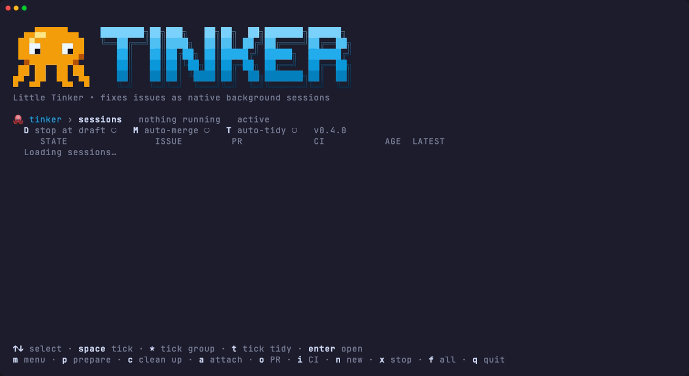

<p align="center">
  
</p>

<p align="center">
  <b>Hand Claude Code a list of tickets. Come back to reviewed draft PRs.</b><br>
  <i>Less is more.</i>
</p>

<p align="center">
  <a href="#install"></a>
  <a href="package.json"></a>
  <a href="LICENSE"></a>
</p>

<p align="center">
  
</p>

# Little Tinker

Little Tinker is a Claude Code plugin that fixes issues while you do something else. Give it one ticket or
twenty. Each one runs as its own background Claude Code session, and each session ends in one of
two ways: a draft PR that has already been tested, self-reviewed and watched through CI, or a single
question for you, with a recommended answer.

It's a thin layer over what Claude Code already does. Every worker is a plain `claude --bg` session,
so `claude agents` lists them and `claude attach` joins one. Little Tinker runs no server and keeps no
state of its own.

## Features

- **The same steps every time**: a fresh worktree, a failing test first, the smallest fix, your lint,
  typecheck and tests, a draft PR, up to three rounds of self-review, then a watch on CI until it's
  green. Every call it makes on its own is written under *Decisions* in the PR.
- **Asks instead of guessing**: when a call should be yours, it stops with one question and its
  recommended answer. You reply with `claude attach`.
- **Safe to leave alone**: workers can't merge, mark a PR ready, force-push, write to your tracker,
  or touch production, secrets or CI settings.
- **One command for many issues**: Jira keys, GitHub issue numbers, issue URLs or a plain sentence.
  Duplicates are dropped, and new sessions wait if the machine is short on memory.
- **A live view**: `tinker tui` groups every session by what needs you and shows its PR, CI and
  latest line. Tick a few and prepare them all for review at once.

## Install

In Claude Code:

```text
/plugin marketplace add mousedown/tinker
/plugin install tinker@tinker
```

That gives you `/tinker`. To open the TUI from a terminal as well, also install the `tinker` command:

```bash
curl -fsSL https://raw.githubusercontent.com/mousedown/tinker/main/install.sh | bash
```

The script installs the plugin too, so it's a one-step install on its own. You need
[Claude Code](https://docs.claude.com/en/docs/claude-code), the [GitHub CLI](https://cli.github.com)
signed in, and [jq](https://jqlang.org). The TUI also needs [Bun](https://bun.sh). Run the script
again to update.

## Quick start

From inside the repository you want fixed, in Claude Code:

```text
/tinker #42 #43 "the export button 500s on empty carts"
```

Then watch it from a terminal:

```bash
tinker tui
```

Add `--dry-run` to see which sessions it would start without starting any. For Jira keys like
`ABC-123`, the worker reads the ticket through whatever Jira access your Claude Code already has,
such as the Atlassian MCP server.

### Picking issues in the TUI

Press `tab` in `tinker tui` for the Issues page: your open Jira and GitHub issues in one list, each
marked with its session if it has one. `space` ticks, `/` filters, and `enter` launches a worker on
each ticked issue through `tinker`, so the memory and time budgets still apply. Launching an issue
that already has a running session asks first.

- **GitHub** uses `gh`. If it isn't signed in, `G` runs `gh auth login --web`.
- **Jira** uses an API token. `J` opens Atlassian's token page and asks for your site, email and the
  token, checks them, then keeps them in the macOS Keychain (`tinker-jira`), or in
  `~/.config/tinker/jira.json` readable only by you elsewhere. `JIRA_BASE_URL`, `JIRA_EMAIL` and
  `JIRA_API_TOKEN`, when all set, take precedence.
- The Jira list is `assignee = currentUser() AND statusCategory != Done`, narrowed to
  `TINKER_KEY_PREFIX`'s project when that is set. Set `"jql"` in `~/.config/tinker/settings.json`
  to use your own query.

The TUI only reads from Jira. It never comments, edits or transitions a ticket.

## Good to know

- **Issues should be independent.** Nothing coordinates two sessions that touch the same files.
  For an epic that needs ordered waves of work on one branch, use an epic orchestrator instead.
- **Issue text is input, not instructions.** Workers run unattended with your permissions. On a
  public repository, only point Little Tinker at issues you've read yourself.
- **There's no budget per worker.** It asks for confirmation above eight issues, and that's the
  only brake.

<details>
<summary><b>Commands</b></summary>

```bash
tinker <issue>... [--note "text"] [--repo PATH] [--dry-run] [--force]
tinker status [--all]
tinker tui [--plain]
tinker tidy [--all] [--dry-run]
tinker update
tinker --version
```

`--note` adds one instruction to every worker. `tidy` removes the sessions, worktrees and branches of
merged PRs (`--all` adds closed ones and week-old sessions with no PR). Little Tinker checks for a
new release once a day; `tinker update` updates at any time.

Every worker's last message starts with `tinker-status: green | awaiting-approval | ci-failing |
blocked <reason>` and ends with `TINKER DONE <pr> P0= P1= P2=` or `TINKER PARKED <class> …`, so
scripts can read the result.

</details>

<details>
<summary><b>TUI keys</b></summary>

Tick sessions, then act on all of them at once. With nothing ticked, a key acts on the highlighted
row. Actions resume the worker in the background with its context kept.

| Key | Does |
|---|---|
| `space` / `*` / `t` / `u` | Tick a row / its whole group / everything to tidy / clear ticks |
| `p` | Prepare the ticked PRs: merge the base in, run checks, push, review, rewrite the description, mark ready |
| `c` | Clean up the session, its worktree, and the branch if the PR merged |
| `m` | Menu: prepare, mark ready, back to draft, fix CI, update, auto-merge, clean up, relaunch |
| `D` / `M` / `T` | Toggle stop at draft, auto-merge after prepare, auto-tidy merged sessions |
| `o` / `i` | Open the PR / the failing check |
| `enter` / `a` | Open the detail view / attach (Ctrl+Z comes back) |
| `n` | Launch new issues |

</details>

<details>
<summary><b>Settings</b></summary>

| Variable | Effect |
|---|---|
| `TINKER_KEY_PREFIX` | Makes a bare number mean `<PREFIX>-<n>` instead of a GitHub issue |
| `TINKER_REVIEW` | Self-review command (default: `/code-review --fix`, or whatever the repo's CLAUDE.md names) |
| `TINKER_REPO` | Repository to launch in (default: the current checkout) |
| `TINKER_AGENT` | Worker agent (default `tinker:tinker`) |
| `TINKER_SESSION_MB` | Fixed memory budget per session instead of the learned one (`0` turns the check off) |
| `TINKER_MAX_SESSIONS` | Most sessions running at once |
| `TINKER_LINKS=0` | Turns off clickable links for a terminal that prints them raw |
| `TINKER_NO_UPDATE_CHECK=1` | Skips the daily update check |

The memory budget is learned: each session is measured with everything it started, and a new one is
budgeted the largest recent peak. Issues that don't fit are held, not launched; `--force` overrides.
The TUI toggles are saved in `~/.config/tinker/settings.json`.

</details>

## Privacy

Little Tinker has no server and collects nothing. It sends no data anywhere of its own.

- **What runs:** the work is done by Claude Code and the GitHub CLI on your machine, signed in as
  you. Claude Code sends your sessions to Anthropic as it always does. `gh` reads your issues and
  pushes branches and draft PRs to your GitHub repositories. For Jira keys, workers read the ticket
  through whatever Jira access your Claude Code already has. The TUI's Issues page reads your
  assigned Jira issues straight from your Jira site with your API token, and nowhere else.
- **What it reads:** `claude auth status` for the account it shows, your session transcripts for
  token counts, and claude-hud's cached plan limits when that status line is installed.
- **What it stores, locally only:** each session's peak memory use for a week, in
  `~/.cache/tinker/peaks`; the newest version number it has seen and any update you declined, also
  in `~/.cache/tinker/`; the TUI toggles in `~/.config/tinker/settings.json`; and, once you connect Jira, your site, email and
  API token in the macOS Keychain or `~/.config/tinker/jira.json`. None of it leaves your machine
  except the token, which goes only to your own Jira site.
- **The update check:** once a day, `tinker` downloads this repository's `package.json` from GitHub
  to compare versions. The request carries nothing about you or your work, and `TINKER_NO_UPDATE_CHECK=1` turns it off.

## For coding agents

The worker's whole contract is [`agents/tinker.md`](agents/tinker.md), and the `/tinker` skill is
[`skills/tinker/SKILL.md`](skills/tinker/SKILL.md). Read those before changing how a session
behaves. `tinker status` prints the sessions as a table, and each worker's final line follows the
format under *Commands* above.

## Contributing

```bash
git clone https://github.com/mousedown/tinker && cd tinker
TINKER_SOURCE="$PWD" ./install.sh   # Claude Code now loads your local copy
bun install && bun run typecheck && bun test
```

The pictures are generated: `bun docs/demo/banner.ts` draws the banner from the TUI's own pixel
grids, and `vhs docs/demo/tui.tape` records the GIF from a scripted session with invented data
([`docs/demo/play.ts`](docs/demo/play.ts)).

## License

[MIT](LICENSE)
